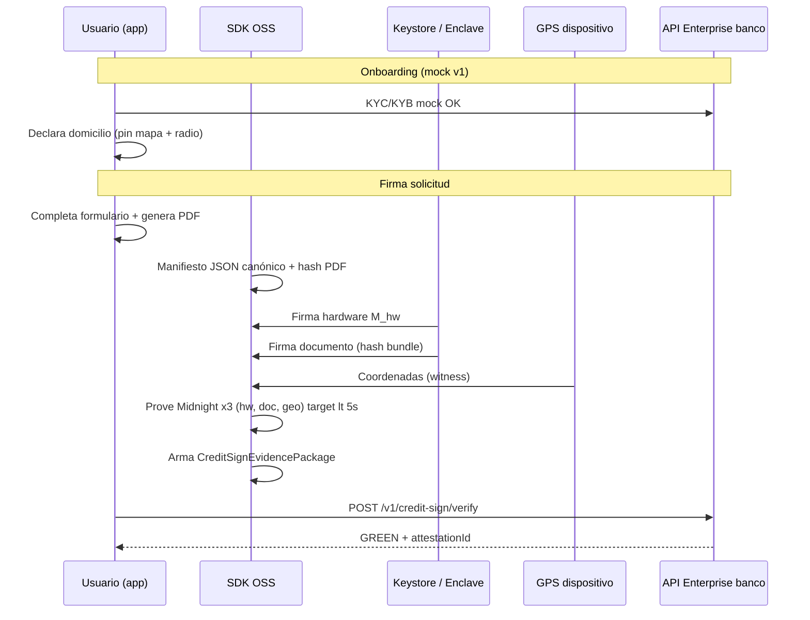

# Happy path — Firma digital de solicitud de crédito/servicios

## User stories (resumen)

| ID | Actor | Objetivo |
|----|-------|----------|
| **US-1** | Institución financiera | Firma remota segura; evidencia ante “no firmé” / “me hackearon”; ZK sin exponer metadata/ubicación exacta al operar; GPS demostrable en juicio dentro de domicilio declarado. |
| **US-2** | PyME / persona | App → KYC/KYB (mock v1) → firma solicitud con dispositivo + GPS en domicilio declarado → banco evita visita presencial. |

**Alcance v1:** solo **happy path**. Identidad (e.firma) **mock**. NOM-151 **fase posterior**.

---

## Decisiones de producto (cerradas)

| Tema | Decisión v1 |
|------|-------------|
| Ancla identidad | **Mock** (fixture / token de sesión) |
| Objeto firmado | **PDF** + **manifiesto JSON** estructurado (enlazados) |
| GPS | Prueba ZK **`inside_range_only`** — el banco solo ve “dentro del radio”, no coordenadas |
| Metadatos dispositivo (OS, modelo, tier) | **Fuera del circuito ZK** — van en paquete de evidencia exportable |
| NOM-151 | **Después** — v1 exporta paquete verificable sin PSC real |
| PyME | **Mismo flujo** que persona; KYB = onboarding previo sin cambiar la prueba |
| Verificación banco | **API Enterprise** recibe paquete → `GREEN` / `RED` |
| Domicilio referencia | Usuario **elige pin en mapa**; radio **máx. 200 m** |
| Coordenadas al banco | **Cifradas** en `sealedGeoArchive` para archivo (operadores no ven lat/lon en claro) |
| Demo PoC | Botón **proof válida** (GPS real) + botón **proof inválida** (coords simuladas fuera de radio) |

---

## Flujo happy path (secuencia)



---

## Capas de evidencia (qué va dónde)

| Dato | ¿ZK v1? | ¿Al banco en operación normal? | ¿En juicio / auditoría? |
|------|---------|-------------------------------|-------------------------|
| Firma hardware válida | **Sí** | Sí (via proof) | Sí |
| Usuario firmó PDF+manifiesto | **Sí** | Sí (commitments) | Sí |
| GPS dentro de radio del domicilio | **Sí** | Solo booleano `insideRange` | Descifrado archivo banco / juicio |
| Coordenadas exactas | Witness ZK | **Cifradas** (`sealedGeoArchive`) | Sí, vía clave del banco |
| OS, modelo, tier enclave | **No** | Solo tier agregado si política | Paquete evidencia adjunto |
| Identidad (RFC, nombre) | **No** (mock v1) | Mock token | e.firma en producción |

---

## Artefacto final: `CreditSignEvidencePackage`

Envelope que envía la app a la API Enterprise (v1 sin NOM-151):

```json
{
  "packageVersion": "1.0.0",
  "sessionId": "uuid",
  "identityMock": { "subjectId": "mock-user-123", "kycStatus": "approved" },
  "domicile": {
    "declaredAt": "2026-06-01T17:00:00Z",
    "centerLat": 19.4326,
    "centerLon": -99.1332,
    "radiusMeters": 200,
    "label": "casa"
  },
  "document": {
    "pdfSha256": "...",
    "manifestSha256": "...",
    "manifest": { }
  },
  "proofs": {
    "hwTrust": {
      "circuitId": "hw-trust-v1",
      "proofProviderId": "midnight",
      "proofBytes": "...",
      "publicInputs": { "hwNullifier": "...", "pubkeyCommitment": "..." }
    },
    "docBind": {
      "circuitId": "doc-bind-v1",
      "proofProviderId": "midnight",
      "proofBytes": "...",
      "publicInputs": { "pdfSha256": "...", "manifestHash": "...", "bundleHash": "..." }
    },
    "geoRange": {
      "circuitId": "geo-range-v1",
      "proofProviderId": "midnight",
      "proofBytes": "...",
      "publicInputs": { "insideRange": true, "radiusMeters": 200 }
    }
  },
  "deviceEvidence": {
    "os": "Android 14",
    "model": "Pixel 8",
    "tier": "High",
    "attestationRef": "optional-hash"
  },
  "sealedGeoArchive": {
    "ciphertextB64": "...",
    "keyId": "bank-archive-key-v1",
    "algorithm": "XChaCha20-Poly1305",
    "plaintextFields": ["actualLat", "actualLon", "capturedAt"]
  },
  "policyId": "credit-sign-mx-v1"
}
```

> **Tres proofs Midnight** (`hw-trust-v1`, `doc-bind-v1`, `geo-range-v1`). Meta **&lt;5 s** prove+verify total. Ver [`ZK_CIRCUIT_STRATEGY.md`](./ZK_CIRCUIT_STRATEGY.md).

---

## Relación con specs existentes

| Spec | Rol en happy path |
|------|-------------------|
| [`HW_TRUST_POC_SPEC.md`](./HW_TRUST_POC_SPEC.md) | Subconjunto: capa hardware + `M_hw` |
| [`M_HW_SPEC_V1.md`](./M_HW_SPEC_V1.md) | Desafío que firma el enclave |
| [`CREDIT_SIGN_MANIFEST_SPEC.md`](./CREDIT_SIGN_MANIFEST_SPEC.md) | Manifiesto JSON + enlace PDF |
| [`GEO_RANGE_PROOF_SPEC.md`](./GEO_RANGE_PROOF_SPEC.md) | Prueba “dentro del radio” |
| [`BANK_VERIFY_API_SPEC.md`](./BANK_VERIFY_API_SPEC.md) | Contrato API Enterprise |
| [`ZK_CIRCUIT_STRATEGY.md`](./ZK_CIRCUIT_STRATEGY.md) | Una proof vs varias (explicación) |
| [`PROOF_PROVIDER_SPEC.md`](./PROOF_PROVIDER_SPEC.md) | Midnight on-device |

---

## Fases de implementación (happy path)

| Fase | Entregable | Historia |
|------|------------|----------|
| **H0** | Specs (este doc + satélites) | — |
| **H1** | Hardware sign + `M_hw` + prove hw (slice actual) | Base dispositivo |
| **H2** | Manifiesto + hash PDF + firma documento | US-1 “firmé el contrato” |
| **H3** | Geo range proof + pin domicilio en app | US-2 sin visita presencial |
| **H4** | `CreditSignEvidencePackage` + API verify mock | US-1 verificación banco |
| **H5** | Demo E2E app → API → GREEN | Happy path completo |
| **H6** | NOM-151 / MED (rama v2) | Fuera v1 |

---

## Criterios de aceptación happy path

- [ ] Usuario mock-KYC → declara domicilio en mapa → firma PDF+manifiesto en app.
- [ ] Tres proofs Midnight on-device; **objetivo** &lt;5 s prove + &lt;5 s verify (documentar si se excede).
- [ ] API Enterprise devuelve `GREEN` con `zkHwTrust`, `zkDocBind`, `zkGeoRange` en pass.
- [ ] Paquete exportado permite reconstruir evidencia para auditor (deviceEvidence legible).
- [ ] Verificador OSS puede validar proofs sin API (paralelo a Enterprise, para auditores).

---

## Fuera de scope v1

- e.firma real, OCSP, revocación SAT
- NOM-151 / PSC
- Biometría obligatoria
- KYB profundo (solo mock gate)
- AML / scoring de riesgo
- iOS (Android APK dev primero)
