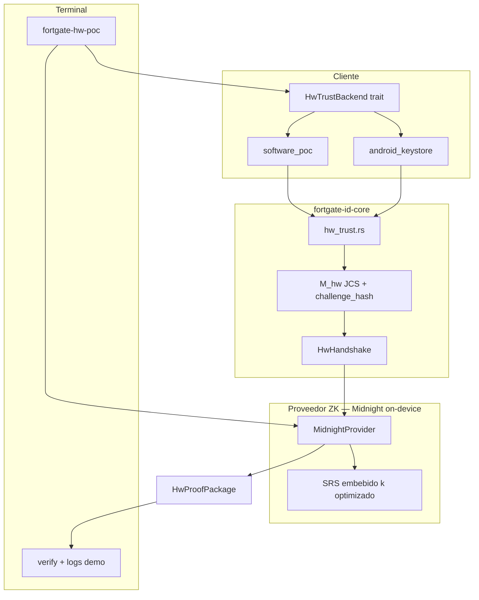

# Hardware Trust PoC — Especificación maestra

| Meta | Valor |
|------|-------|
| Rama | `feat/hw-trust-poc` |
| Alcance | **Slice H1** del happy path crédito: firma hardware + ZK. Ver [`HAPPY_PATH_CREDIT_SIGN_SPEC.md`](./HAPPY_PATH_CREDIT_SIGN_SPEC.md) |
| Plataformas | Terminal (macOS/Linux) + APK Android dev |
| Proveedor ZK | **Midnight** (`midnight-zk-stdlib`) — prove on-device; SP1 **fuera de scope** en hw-trust |

Documentos relacionados:

- [`HAPPY_PATH_CREDIT_SIGN_SPEC.md`](./HAPPY_PATH_CREDIT_SIGN_SPEC.md) — user stories y flujo E2E
- [`CREDIT_SIGN_MANIFEST_SPEC.md`](./CREDIT_SIGN_MANIFEST_SPEC.md) — PDF + manifiesto (fase H2)
- [`GEO_RANGE_PROOF_SPEC.md`](./GEO_RANGE_PROOF_SPEC.md) — georango ZK (fase H3)
- [`BANK_VERIFY_API_SPEC.md`](./BANK_VERIFY_API_SPEC.md) — API Enterprise (fase H4)

---

## 1. Objetivo del PoC

Demostrar que un dispositivo puede:

1. Mantener una llave ECDSA P-256 en un backend de confianza (simulado o Keystore).
2. Firmar un desafío `M_hw` sin exponer la clave privada.
3. Generar una **prueba ZK** verificable en terminal que ata la firma a un `pubkey_commitment` y un `hw_nullifier`.
4. Generar la prueba **en el mismo dispositivo** que firma (objetivo UX), sin exportar a laptop para probar.

**Explícitamente fuera de scope:**

- Biometría obligatoria (puede añadirse opcional en v1.1).
- Vínculo con e.firma real (identidad **mock** en v1).
- NOM-151 / PSC (paquete exportable sí; sello no).
- Manifiesto PDF, geo range, API banco (specs listos; implementación H2–H4).

---

## 2. Arquitectura



---

## 3. Componentes a implementar (por fase)

### 3.1 Core Rust (`open/client-sdk/`)

| Módulo | Responsabilidad |
|--------|-----------------|
| `hw_trust.rs` | Tipos, commitment, nullifier, validación |
| `hw_trust/backends/software_poc.rs` | Desktop simulado |
| `hw_trust/backends/mod.rs` | Trait `HwTrustBackend` |
| `enclave_wrapper.rs` | Deprecar stub gradualmente; reexportar desde `hw_trust` |

### 3.2 CLI (`fortgate-hw-poc`)

Binario en `open/client-sdk/src/bin/hw_poc.rs` o crate `fortgate-hw-cli`.

| Subcomando | Descripción |
|------------|-------------|
| `keygen` | Crea llave `software_poc` en `~/.fortgate/poc_hw/` |
| `challenge` | Emite `challenge.json` (`M_hw`) |
| `sign` | Produce `handshake.json` |
| `prove` | Genera proof Midnight → `hw_output/` (local o vía FFI en APK) |
| `verify` | Verifica proof + handshake |
| `demo` | Un solo comando: challenge → sign → prove → verify + logs (ver DEMO doc) |

### 3.3 Midnight (`open/client-sdk/hw-midnight/`)

Crate con `Relation` `HwTrustRelationV1` vía `midnight-zk-stdlib`. Prove/verify en **desktop y Android** (mismo crate Rust vía UniFFI/JNI). Ver `PROOF_PROVIDER_SPEC.md`.

> **SP1 no aplica a hw-trust.** El stack SP1 existente (`sp1-prover/`) sigue reservado al flujo **e.firma / identidad RSA-2048**.

### 3.4 Android (`android/hw-poc-app/`)

APK dev mínima: Init → Sign → Export handshake. Sin biometría en v1.

---

## 4. Trait `HwTrustBackend`

```rust
pub enum HwBackend {
    SoftwarePoc,
    AndroidKeystore,
    IosSecureEnclave, // stub futuro
}

pub trait HwTrustBackend {
    fn backend_id(&self) -> HwBackend;
    fn detect_tier(&self) -> SecurityTier;
    fn pubkey_spki_der(&self) -> Result<Vec<u8>>;
    fn sign_challenge_hash(&self, challenge_hash: &[u8; 32]) -> Result<Vec<u8>>;
    /// Certificados DER de attestation (Android). Vacío en software_poc.
    fn attestation_chain(&self) -> Option<Vec<Vec<u8>>>;
}
```

### Mapeo tier ↔ backend

| Backend | Tier asignado | Notas |
|---------|----------------|-------|
| `software_poc` | `Medium` | Banner **DEV ONLY** en logs |
| Android software-backed | `Medium` | Verificador YELLOW |
| Android TEE / hardware | `High` | Dispositivo físico |
| Android StrongBox | `Maximum` | Si `SecurityLevel.STRONGBOX` |
| iOS Secure Enclave | `Maximum` | Futuro |

**Biometría:** no requerida en v1. Android Keystore se crea con `setUserAuthenticationRequired(false)` en PoC.

---

## 5. `HwHandshake` v1

```json
{
  "packageVersion": "1.0.0",
  "m_hw": { },
  "challengeHash": "64-hex",
  "pubkeySpkiDer": "base64",
  "pubkeyCommitment": "64-hex",
  "signatureDer": "base64",
  "tier": "High",
  "backend": "android_keystore",
  "signedAt": "2026-06-01T18:00:30Z",
  "attestationChainDer": ["base64-cert-1", "base64-cert-2"]
}
```

Validación antes de `prove`:

- Recomputar `challenge_hash` desde `m_hw` (JCS).
- Recomputar `pubkey_commitment`.
- Verificar ECDSA localmente (sanity check).
- Comprobar `expiresAt`.

---

## 6. Nullifier hardware

Dominio separado del nullifier de identidad (`0x4647`):

```
hw_nullifier = Poseidon_2( Fr(pubkey_commitment_bytes), Fr(0x4648) )
```

`0x4648` = `"FH"` (Fortgate Hardware). Misma curva BN254 / reglas que `field_encoding.rs` cuando se serialice a hex 64 chars.

---

## 7. Política de prueba y tiers

```rust
pub struct HwTrustPolicy {
    pub min_tier: SecurityTier,
    pub allow_software_poc: bool,  // default true en dev, false en demo "banco"
    pub proof_provider: ProofProviderId,
}
```

El ZK **no** demuestra que el tier es honesto; la política del verificador combina:

- Proof ZK válido (obligatorio).
- `tier >= min_tier` según declaración.
- Attestation parse (opcional L2, YELLOW si falta).

---

## 8. Android APK dev

| Requisito | Valor |
|-----------|-------|
| Min SDK | 28 |
| Target | 34 |
| Permisos | Ninguno especial PoC (sin biometría) |
| Keystore | EC secp256r1, alias `fortgate_hw_poc` |
| Attestation | `setAttestationChallenge(challenge_hash)` |
| FFI | UniFFI: `sign_hw_challenge(challenge_json: String) -> String` |
| Export | `handshake.json` en app files + share intent |
| Prove en device | **Sí** — objetivo PoC vía crate `hw-midnight` enlazado en APK |
| Fallback dev | Terminal `fortgate-hw-poc prove` si el spike Android no está listo |

### Flujo objetivo (todo en teléfono)

1. App genera o importa `challenge.json`.
2. Keystore firma → `handshake` interno.
3. **Midnight prove on-device** → `proof_package.json`.
4. Export/share o `adb pull` solo para **verificar en terminal** (verify es &lt;5 ms).

### Flujo fallback (desarrollo)

```bash
fortgate-hw-poc challenge --out /tmp/challenge.json
adb push /tmp/challenge.json /sdcard/Download/
# Teléfono: solo firma (sin prove) → handshake.json
adb pull /sdcard/Download/handshake.json /tmp/
fortgate-hw-poc prove --handshake /tmp/handshake.json   # laptop
fortgate-hw-poc verify --package hw_output/proof_package.json --handshake /tmp/handshake.json
```

---

## 9. Desktop `software_poc`

Simula Secure Enclave para desarrollo y demo rápida:

- Llave P-256 en `~/.fortgate/poc_hw/key.pem` (o PKCS#8).
- Tier fijo `Medium`.
- Logs explícitos: `⚠️  software_poc — no es hardware real`.

Permite correr `fortgate-hw-poc demo` sin teléfono; slice H1 solo corre proof #1 (`hw-trust-v1`). E2E tres proofs en fase H5.

---

## 10. Plan de implementación

| Fase | Duración | Entregable |
|------|----------|------------|
| **0 — Specs** | ✓ | Este doc + M_hw + Provider + Demo |
| **1 — Core + CLI** | 3–4 d | `hw_trust`, `software_poc`, sign/verify-local |
| **2 — Midnight `hw-trust-v1`** | 5–7 d | Spike ECDSA P-256; meta prove &lt;2 s |
| **3 — `doc-bind-v1` + `geo-range-v1`** | 5–7 d | Proofs #2 y #3; orquestador `prove_all` |
| **4 — Prove on-device** | 3–5 d | UniFFI; tres proofs en APK; meta total &lt;5 s |
| **5 — Demo script** | 1–2 d | `demo/hw-trust-demo.sh`, modo record |
| **6 — APK pulido** | 3–4 d | Keystore, tres proofs, export package |

---

## 11. Criterios de aceptación PoC

- [ ] `fortgate-hw-poc demo` termina GREEN en laptop (proof #1; meta &lt;2 s) sin teléfono.
- [ ] APK en dispositivo físico: sign + prove on-device GREEN con `tier >= High`.
- [ ] Verify en terminal con `proof_package` exportado (&lt;5 ms).
- [ ] Verificador independiente con solo `proof_package.json` + `vkey.json` + `handshake.json`.
- [ ] Documentación deja claro qué es simulado vs real.

---

## 12. Riesgos

| Riesgo | Mitigación |
|--------|------------|
| Midnight sin chip P-256 nativo | Spike Fase 2: circuito custom o chips bigint; ver `PROOF_PROVIDER_SPEC.md` |
| Confundir simulador con enclave real | `backend` + logs + política `allow_software_poc` |
| Divergencia JCS Kotlin vs Rust | Canonicalización solo en Rust; APK recibe JSON ya emitido por CLI o valida vía FFI |
| Prove lento en gama media Android | Tres circuitos Small; meta &lt;5 s total; spinner async si se excede |

---

## 13. Referencias internas

- `open/client-sdk/src/enclave_wrapper.rs` — stub actual
- `open/client-sdk/src/hardware.rs` — `SecurityTier`
- `cursor-fortgate-context.md` — contexto histórico
- Midnight: https://crates.io/crates/midnight-zk-stdlib
